# Rocking-Arm Kite Power Generation (KEEP): Compact Numerical Analysis

**Research question:** *Given a kite tethered to a rotating ground-level arm that is pulled left and right across the wind window, how much average power can we expect, and how robust is the design?*

Structure follows the finished ECC paper (model, equilibria and limit cycles, limit-cycle optimization) in a condensed form; the full derivations live in the JTCAM draft. Every figure below is accompanied by the numerical data needed to write the final prose without re-running any computation. Plot styling is local to each section so it can be iterated on by hand.


````
  Activating project at `~/git/KEEP.jl/applications/jtcam`

````

Shared guide lines for the optimization panels. Kept here, next to the plots
that use it, because it is pure styling.


````
(ymin = 0.9, line = (c = :black, lw = 5, alpha = 0.3), floor = (c = :black, lw = 1, alpha = 1))
````

One call site for every numerical study. FORCE_RECOMPUTE=1 recomputes all;
otherwise a single hash of all compute inputs decides. See paper_cache.jl.


````
┌ Info: Optimal torque slope value
└ b ≈ 50.41 N m deg s⁻¹, set by the kinetic criterion from the simulated limit-cycle period.
%% BEGIN TABLE 1

\begin{table}[thpb]
\centering
\caption{Parameter Description and Values}
\label{tab:params}
\begin{tabular}{l p{3.2cm} r l}
    \toprule
    {Symbol} & {Description} & {Value} & {Unit} \\
    \midrule
    $a$ & Arm length & $2$ & \si{\meter} \\ 
    $b$ & Arm braking coefficient & $50.407839$ & \si{\newton\meter\second\per\degree} \\ 
    $C_D$ & Kite drag coefficient & $C_L / 7$ &  \\ 
    $C_{D,\ell}$ & Line drag coefficient & $0$ &  \\ 
    $C_L$ & Kite lift coefficient & $0.6$ &  \\ 
    $d_\ell$ & Line diameter & $0.003$ & \si{\meter} \\ 
    $g$ & Gravity & $9.81$ & \si{\meter\per\square\second} \\ 
    $I$ & Arm inertia & $1300$ & \si{\kg\square\meter} \\ 
    $\ell$ & Line length & $31$ & \si{\meter} \\ 
    $m$ & Kite mass & $6$ & \si{\kg} \\ 
    $S$ & Kite surface & $10$ & \si{\square\meter} \\ 
    $w_0$ & Wind reference speed & $9$ & \si{\meter\per\second} \\ 
    $z_0$ & Wind reference altitude & $10$ & \si{\meter} \\ 
    $\Delta\theta$ & Lemniscate polar half-height & $6$ & \si{\degree} \\ 
    $\Delta\phi$ & Lemniscate azimuthal half-width & $50$ & \si{\degree} \\ 
    $\theta_0$ & Lemniscate mean polar angle & $65$ & \si{\degree} \\ 
    $\rho_a$ & Air density & $1.225$ & \si{\kg\per\cubic\meter} \\ 
    $\rho_\ell$ & Line density & $707$ & \si{\kg\per\cubic\meter} \\ 
    \bottomrule
\end{tabular}
\end{table}

%% END TABLE 1
[ Info: Chance to use Poincaré-Miranda theorem here?
[ Info: Are lines and arm aligned at equilbrium? YES.
┌ Info: Each revolution, the distance is divided by 10^slope. The eigenvalues λ are the dominant non-unit Floquet multipliers found with differentiation.
│ D(τ) > 0: secant slope = 2.133, Floquet slope = 2.070, T = 2.828076, λ = 0.008517
└ D(τ) < 0: secant slope = 2.156, Floquet slope = 2.098, T = 2.710029, λ = 0.007983
┌ Info: Average power
│ D(τ) > 0 : 9.64 kW,
└ D(τ) < 0 : 9.03 kW,
┌ Info: Limit cycle inventory over α ∈ [0, 180] deg, τ ∈ [-180, 180) deg, (dα, dτ) ∈ [-573, 573] deg/s (half the torus, modulo S; symmetry residual 4e-15)
│ Single shooting (100 Halton seeds → 48/52 per sign of dτ, 50 turns, deflation): 0 cycle(s) beyond the two references; references re-solved with residual 1e-10
└ Quasi-Monte-Carlo (100 Halton seeds, stable cycles only): 48 → D(τ) > 0, 52 → D(τ) < 0, 0 → none
[ Info: opt: reference at 9.0 m/s over Θ = (l, I, b, Δφ)

******************************************************************************
This program contains Ipopt, a library for large-scale nonlinear optimization.
 Ipopt is released as open source code under the Eclipse Public License (EPL).
         For more information visit https://github.com/coin-or/Ipopt
******************************************************************************

[ Info: opt: wind sweep, 11 speeds from 5.0 to 15.0 m/s
[ Info:   wind sweep 5/11: 9.0 m/s
[ Info:   wind sweep 4/11: 8.0 m/s
[ Info:   wind sweep 3/11: 7.0 m/s
[ Info:   wind sweep 2/11: 6.0 m/s
[ Info:   wind sweep 1/11: 5.0 m/s
[ Info:   wind sweep 6/11: 10.0 m/s
[ Info:   wind sweep 7/11: 11.0 m/s
[ Info:   wind sweep 8/11: 12.0 m/s
[ Info:   wind sweep 9/11: 13.0 m/s
[ Info:   wind sweep 10/11: 14.0 m/s
[ Info:   wind sweep 11/11: 15.0 m/s
[ Info: opt: Δθ sweep with Θ fixed, 10 angles
[ Info: opt: Δθ sweep with Θ re-optimized, 10 angles
[ Info:   Δθ re-optimization 3/10: 6.0°
[ Info:   Δθ re-optimization 2/10: 4.0°
[ Info:   Δθ re-optimization 1/10: 2.0°
[ Info:   Δθ re-optimization 4/10: 8.0°
[ Info:   Δθ re-optimization 5/10: 10.0°
[ Info:   Δθ re-optimization 6/10: 12.0°
[ Info:   Δθ re-optimization 7/10: 14.0°
[ Info:   Δθ re-optimization 8/10: 16.0°
[ Info:   Δθ re-optimization 9/10: 18.0°
[ Info:   Δθ re-optimization 10/10: 20.0°
[ Info: opt: shape map 10×10 at the optimal ℓ, I, b
[ Info:   shape map row 1/10: Δφ = 10.0°
[ Info:   shape map row 2/10: Δφ = 18.88888888888889°
[ Info:   shape map row 3/10: Δφ = 27.77777777777778°
[ Info:   shape map row 4/10: Δφ = 36.666666666666664°
[ Info:   shape map row 5/10: Δφ = 45.55555555555556°
[ Info:   shape map row 6/10: Δφ = 54.44444444444444°
[ Info:   shape map row 7/10: Δφ = 63.333333333333336°
[ Info:   shape map row 8/10: Δφ = 72.22222222222223°
[ Info:   shape map row 9/10: Δφ = 81.11111111111111°
[ Info:   shape map row 10/10: Δφ = 90.0°
[ Info: opt: objective landscape around the Θ optimum

final parameters
                                        init             Θ
ℓ (m)                                   31.0       26.9679
I (kg m²)                             1300.0       351.628
b (N m deg s⁻¹)                      50.4078       12.8643
Δφ (deg)                                50.0       16.6158
Δθ (deg, fixed)                          6.0           6.0

period (s)                           2.82808      0.949266
objective P (kW)                      9.6389       12.2534
min tension (kN)                     3.35562       5.74768
max tension (kN)                     8.85562       10.8269
max acceleration (m/s²)              517.092       938.606
max kite speed (m/s)                 49.2576       54.6334

wind sweep over Θ (reference at 9 m/s)
v (m/s) fixed P   opt P     gain    Tmax opt  ℓ (m)    I        b        Δφ (deg)
5       1.894     2.149     +13.5 % 3.49      30.34    451.3    8.7      17.6
6       3.463     3.675     +6.1 %  4.93      28.78    405.4    9.6      17.22
7       5.672     5.801     +2.3 %  6.63      27.89    379.1    10.6     16.95
8       8.585     8.627     +0.5 %  8.6       27.34    362.7    11.7     16.76
9       12.253    12.253    -0.0 %  10.83     26.97    351.6    12.9     16.62
10      16.717    16.78     +0.4 %  13.32     26.71    343.9    14.0     16.51
11      22.008    22.306    +1.4 %  16.08     26.52    338.3    15.2     16.43
12      28.155    28.933    +2.8 %  19.09     26.37    334.0    16.4     16.37
13      35.18     36.759    +4.5 %  22.38     26.26    330.7    17.6     16.33
14      43.103    45.885    +6.5 %  25.92     26.17    328.1    18.9     16.29
15      51.94     56.412    +8.6 %  29.72     26.1     326.1    20.1     16.26

Δθ sweep: Θ fixed against re-optimized (nominal Δθ = 6.0 deg)
Δθ (deg)  P0 (kW)  P (kW)   gain    Tmax0 (kN)  Tmax (kN)  amax0    amax
2.0       3.96     12.82    +223 %  13.83       10.39      5499     1636
4.0       9.08     12.76    +41 %   12.78       10.44      1447     1730
6.0       12.25    12.25    —       10.83       10.83      939      939
8.0       9.74     11.70    +20 %   10.75       10.84      1851     831
10.0      5.77     11.13    +93 %   12.87       10.76      2533     864
12.0      3.28     10.56    +222 %  13.36       10.64      2994     925
14.0      2.04     10.00    +390 %  13.59       10.49      3477     1005
16.0      1.38     9.44     +583 %  13.79       10.32      3997     1106
18.0      0.99     8.86     +793 %  13.74       10.12      4541     1233
20.0      0.75     8.27     +1010 % 13.51       9.90       5115     1400

shape map (no re-optimization, 10×10 limit cycles)
  valid: 90 of 100 cells
  P    1.21 … 12.46 kW
  Tmax 10.06 … 14.96 kN
  Tmin 0.13 … 10.51 kN
  max a: 4731.0 m/s² at Δθ = 20.0 %, Δφ = 10.0 deg

landscape at the Θ optimum (power relative to the optimum)
parameter   at -10 %    at +10 %    box (÷/×)
ℓ           0.8854      0.9193      (0.556, 7.416)
I           0.9738      0.9728      (0.176, 2843.915)
b           0.9962      0.9968      (0.001, 1356.718)
Δφ          0.9457      0.9711      (0.602, 5.417)
%% BEGIN TABLE 2

\begin{table}[thpb]
\centering
\caption{Description of the optimized parameters ($\Delta\theta = \SI{6.0}{\degree}$ fixed).}
\begin{tabular}{l S S}
    \toprule
    {Symbol (Unit)} & {Lower bound} & {Upper bound} \\
    \midrule
    $\ell$ (\si{\meter}) & 15.0 & 200.0 \\ 
    $I$ (\si{\kilogram\meter\squared}) & 62.0 & 1000000.0 \\ 
    $b$ (\si{\newton\meter\second\per\degree}) & 0.0175 & 17453.3 \\ 
    $\Delta\varphi$ (\si{\degree}) & 10.0 & 90.0 \\ 
    \bottomrule
\end{tabular}
\label{tab:opt_descr}
\end{table}

\begin{table}[thpb]
\centering
\caption{Optimization results at $w_0 = \SI{9}{\meter\per\second}$.}
\begin{tabular}{l S S}
    \toprule
    {Symbol (Unit)} & {Initial Guess} & {Solution} \\
    \midrule
    $\ell$ (\si{\meter}) & 31.0 & 27.0 \\ 
    $I$ (\si{\kilogram\meter\squared}) & 1300.0 & 351.6 \\ 
    $b$ (\si{\newton\meter\second\per\degree}) & 50.4 & 12.9 \\ 
    $\Delta\varphi$ (\si{\degree}) & 50.0 & 16.6 \\ 
    \midrule
    Average power (\si{\kilo\watt}) & 9.64 & 12.25 \\ 
    Period (\si{\second}) & 2.83 & 0.95 \\ 
    Min line tension (\si{\kilo\newton}) & 3.36 & 5.75 \\ 
    Max line tension (\si{\kilo\newton}) & 8.86 & 10.83 \\ 
    Max kite speed (\si{\meter\per\second}) & 49.26 & 54.63 \\ 
    Norm of residual & {$2.2\times10^{-6}$} & {$5.1\times10^{-6}$} \\ 
    \bottomrule
\end{tabular}
\label{tab:opt_results}
\end{table}

%% END TABLE 2

````

## 1. Model and Geometry

The kite is constrained to a lemniscate on a cone; the arm rotates in the horizontal plane. The two figures below fix the geometry and the meaning of the shape parameters $(\theta_0, \Delta\theta, \Delta\varphi)$ and of the phase $\tau$.

Geometry of the reachable set. `a = 2 m`, `ℓ = 3 m` are illustrative, not the optimized values.

````julia


````

**Figure data — geometry.** Arm $a = 2$ m, tether $\ell = 3$ m; the sampled elevation is $\beta_0 = 30.0^\circ$, so the kite sits at [4.6, 0.0, 1.5] m. The reachable set is a spindle torus because $\ell > a$; the arm-tip locus is the blue circle. The lemniscate uses $\tau_\varphi = 90.0^\circ$ and $\tau_\theta = 225.0^\circ$ as illustration angles; increasing $\dot\tau$ climbs in the middle, decreasing $\dot\tau$ climbs on the sides.

**Prose hint:** these two panels replace the configuration sketch and the lemniscate sketch of the ECC paper; cite them when introducing $(\alpha, \tau)$ and $(\theta_0, \Delta\theta, \Delta\varphi)$.

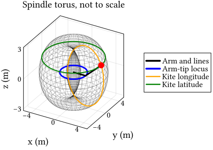

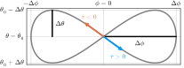


## 2. Equilibria and Limit Cycles

All computations use the kinetic baseline $b = I\\omega$ (`PMP.optimal_torque_slope`), which gives one limit cycle per iteration. The phase-space picture, the two attracting cycles and their convergence rate are the ingredients needed for the dynamics section of the final paper.

````julia


````

**Figure data — equilibria.** There are 8 equilibria, all unstable: the largest real eigenvalue lies in $[-0.0, 12.89]\,\text{s}^{-1}$. The arm and lines are coplanar at every equilibrium (true). The two top views separate 4 downwind from 4 upwind equilibria.

**Figure data — limit cycles.** The two attracting cycles carry $P_+ = 0.009$ (Floquet multiplier) and $P_- = 0.008$. Their convergence slopes are D(τ) > 0: secant slope = 2.133, Floquet slope = 2.070, T = 2.828076, λ = 0.008517 and D(τ) < 0: secant slope = 2.156, Floquet slope = 2.098, T = 2.710029, λ = 0.007983. A deflated-shooting inventory over 100 Halton seeds finds 0 additional cycles; quasi-Monte-Carlo routes 48 / 100 seeds to $D(\tau)>0$, 52 / 100 to $D(\tau)<0$, and 0 elsewhere.

**Figure data — trajectories near equilibria.** Each panel seeds 100 trajectories on a circle of radius $\pi/10$ at rest around one equilibrium and integrates them for 1 s; the translucent black curves show the local flow directly.

**Figure data — convergence.** Averaged over the two directions, the Poincaré map loses about two digits of distance per revolution until the solver tolerance $10^{-13}$ is reached. The slope printed in each panel is the quantity to quote in prose; the dashed perturbed cloud is deliberately absent here ($n\text{trace}=0$).

**Prose hint:** the two cycles are distinct in the $YZ$ projection (zoom inset), so the phase of $\tau$ is physically meaningful; the deflation plus QMC inventory supports the claim that only two attracting cycles exist.

**Open questions from the JTCAM draft:** confirm the colour-code wording in the phase-space caption (max $\mathrm{Re}(\lambda)\approx 3$ for the circle and $\approx 12$ for the diamonds); decide whether to keep the coplanarity remark in the main text or the appendix.

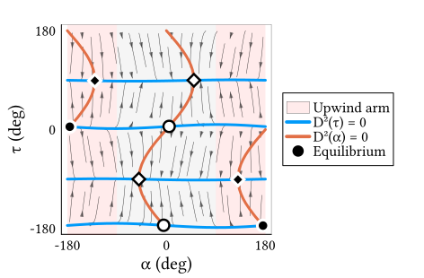

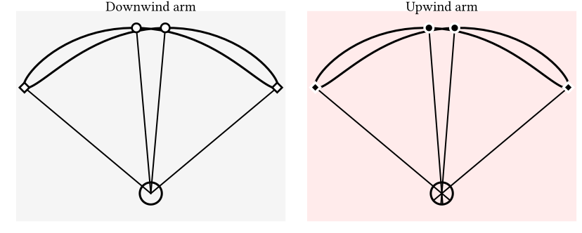

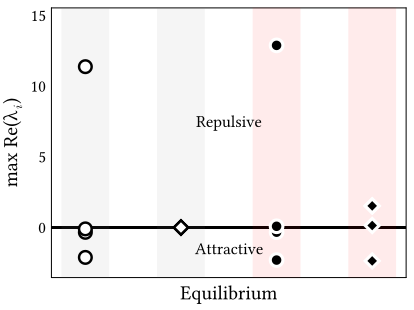

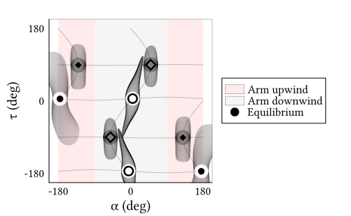

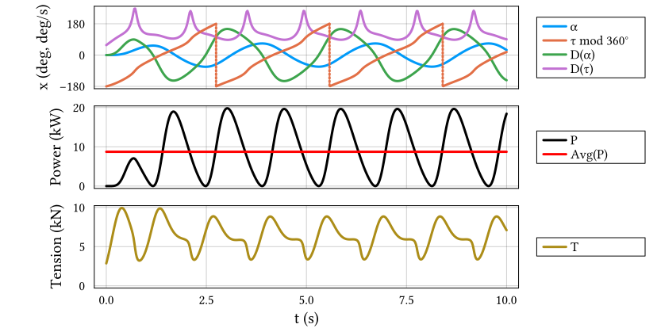

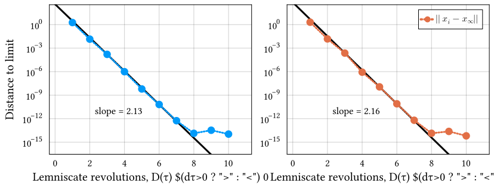

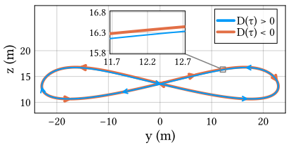


## 3. Limit-Cycle Optimization and Robustness

We maximize $\\bar P = W(t_f)/t_f$ subject to periodic closure over $\\Theta = (\\ell, I, b, \\Delta\\varphi)$ at $w_0 = 9$ m/s with $\\Delta\\theta = 6^\\circ$ fixed. The reference is the kinetic PTO point ($b = I\\omega$), then $\\Theta$ is optimized. Every panel below comes from the cached `results.OPT` bundle.

````julia


````

**Figure data — optimum.** The reference (PTO) point gives 12.25 kW; the $\Theta$ optimum gives 56.41 kW at the reference wind. The achieved optimum is $\ell = 26.97$ m, $I = 351.6$ kg m², $b = 737.1$ N m s rad⁻¹, $\Delta\varphi = 16.62^\circ$. Ipopt converged in 20 iterations in 0.58 s.

**Figure data — landscape.** $\ell$ is the stiffest direction ($(-11.5\%, -8.1\%)$ at $\pm 10\%$), $I$ is about four times flatter ($-2.6\%$) and $b$ more than twenty times flatter ($-0.4\%$). The $\Delta\varphi$ optimum ($16.6^\circ$) is interior: $-5.4\%$ at $15.0^\circ$, $-2.9\%$ at $18.3^\circ$. The box lower bounds on $\ell$, $I$ and $b$ are far from the optimum, so none binds.

**Figure data — Δθ sweep.** At fixed $\Theta$ the power falls from $12.25$ kW at $6^\circ$ to $3.96$ kW at $2^\circ$ and $0.75$ kW at $20^\circ$, while $T_{\max}$ rises to $13.8$ kN at both ends. Re-optimizing $\Theta$ recovers $12.82$ kW at $2^\circ$ and $8.27$ kW at $20^\circ$, with flatter loads ($T_{\max} = 9.9$–$10.8$ kN). The re-optimized power peaks at $2$–$4^\circ$, $4.6\%$ above the nominal point.

**Figure data — shape map.** At fixed optimal $\ell, I, b$ the map peaks at $\Delta\theta = -20\%$, $\Delta\varphi = 18.9^\circ$ with $12.46$ kW and collapses to $2$–$3$ kW for $\Delta\varphi \ge 36.7^\circ$; $\Delta\varphi = 90^\circ$ has no pumping cycle at any $\Delta\theta$.

**Figure data — wind sweep.** Re-optimizing gains $+13.5\%$ at $5$ m/s and $+8.6\%$ at $15$ m/s. $\ell$ shortens $30.3 \to 26.1$ m and $I$ falls $451 \to 326$ kg m² with wind, while $b$ rises $498 \to 1151$ and $\Delta\varphi$ closes $17.6^\circ \to 16.3^\circ$. $T_{\min}$ stays positive throughout, confirming the taut-line assumption a posteriori.

**Prose hint:** these panels support the ECC conclusions — roughly cubic power scaling, quadratic tension scaling and near-linear braking coefficient in wind speed, with little loss when the $9$ m/s design is held fixed.

**Open questions from the JTCAM draft:** state explicitly which variables sit on their box bounds in the landscape; decide whether to quote the $13\%$ optimization gain from the finished ECC paper or the value computed here; decide whether the Δθ panel belongs in the main text or the appendix.

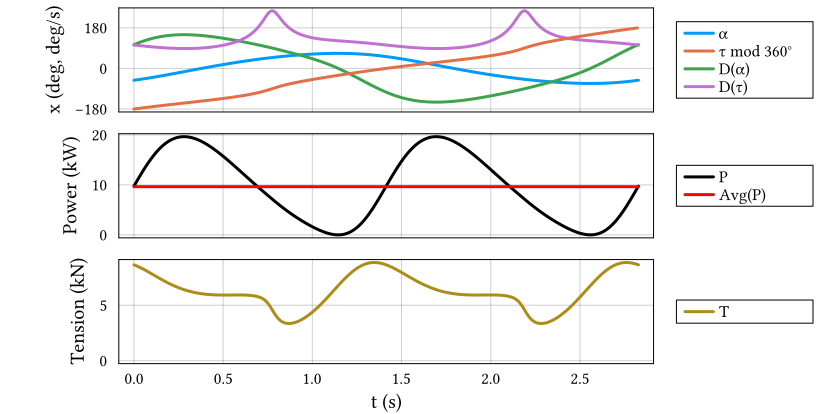

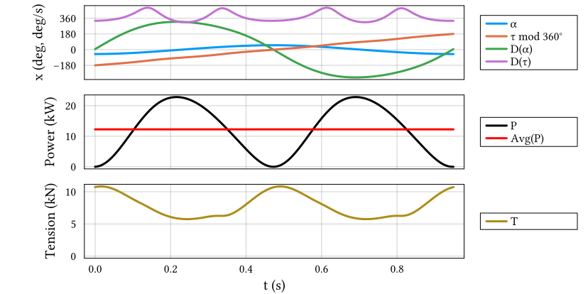

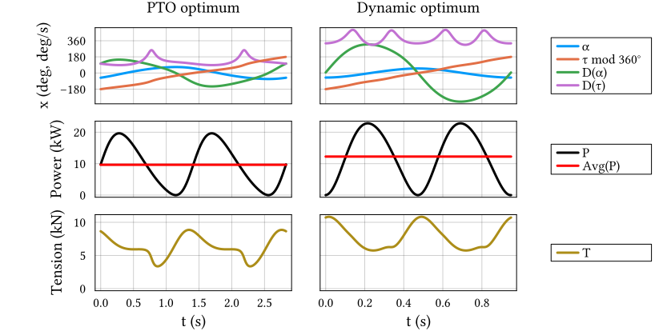

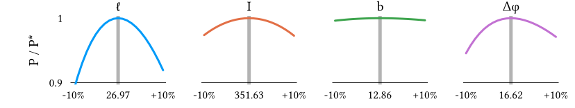

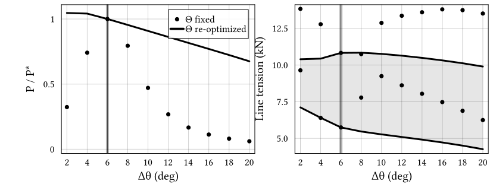

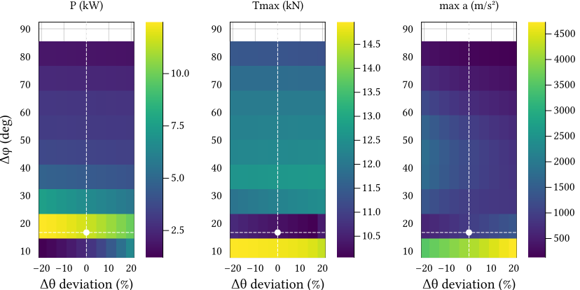

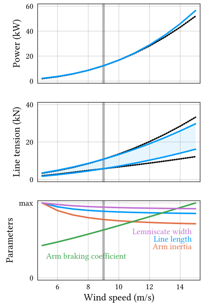

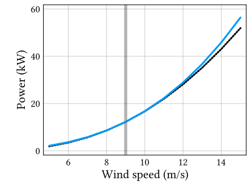

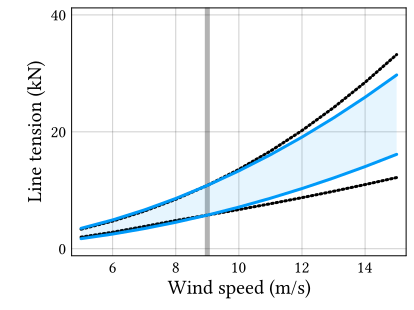

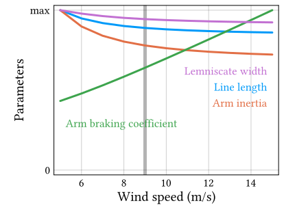


## 4. Conclusion

The reduced 4D model reproduces the 10D dynamics without drift and at lower cost; it has two attracting limit cycles; optimizing the design parameters raises average power substantially and the $9$ m/s optimum is robust over $5$–$15$ m/s with positive line tension. The figures above carry the numbers needed to write the corresponding paragraphs.

## Appendix A. Validation of the 4D reduction

The original 10D DAE drifts when integrated without a manifold-projection callback. The callback removes the drift at a runtime cost; the 4D model has no algebraic constraint at all.

````julia


````

**Figure data — 10D drift and callback.** At $t_f = 100$ s and tolerance $10^{-3}$, the raw 10D solution drifts; the projection callback keeps the manifold residual near the callback tolerance $10^{-10}$. The callback costs 1.09× the runtime of raw 10D.

**Figure data — convergence.** Against a 4D reference at tolerance $10^{-14}$, all three formulations converge to the same trajectory as the tolerance decreases from $10^{-2}$ to $10^{-12}$; the 4D model has no drift by construction. At the production tolerance the 4D run takes 2.21 ms versus 45.19 ms for raw 10D (20.5× slower) and 49.3 ms for 10D with callback (22.3× slower).

**Prose hint:** the horizontal axis is reversed so that tighter tolerances progress to the right; quote the drift number and the speedup together, as in the ECC paper's model-validation paragraph.

**Open question from the JTCAM draft:** consider dropping the left subplot of the trajectory figure (it duplicates the long-horizon panel); it is kept here for parity with the legacy figure set.

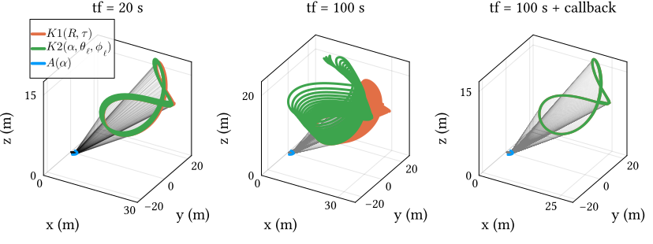

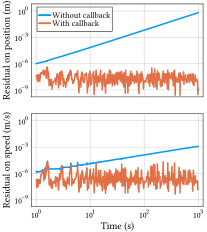

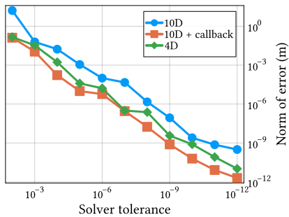


